# Ligand activity ML — and how much of it survives an honest test

Machine learning models that predict whether a compound is active at a
protein target from its 2D structure alone, built across **five human
targets and 32,540 compounds** of real ChEMBL bioactivity data.

The models work. The point of this repository is the second question:
**how much of "working" is an artefact of how the test set was chosen?**

Changing nothing but the train/test split — same data, same models, same
seed — moves the headline number from **ROC AUC 0.88 to 0.79 to 0.71**, and
regression R² from **0.67 to 0.46 to 0.23** (random forest; averaged over
every model it is 0.59 to 0.34 to **−0.03**, worse than predicting the
training mean). The ROC AUC gap holds in **20 of 20** target × model cells,
95% CI 0.070–0.088. Every number below was produced by the code in this
repository, on data it fetched itself.

---

## The problem

A screening library has millions of compounds. An assay costs money and a
chemist's week per plate. So nobody tests the library — they rank it, test
the top, and throw the rest away. The ranking *is* the product, and a
ligand-based model that has seen which compounds were active at a target
before is the cheapest way to produce one: a fingerprint costs microseconds,
a dose–response curve costs days.

That makes the honest question not "is the model accurate?" but **"is it
accurate on the compounds I am actually going to ask it about?"** Those are
never the compounds it was trained on, nor close analogues of them. They are
new chemistry — a scaffold nobody has tried, a series designed next year.

A random train/test split does not ask that question. It scatters members of
the same congeneric series across both sides, so the test set is full of near
neighbours of training compounds and the model can score well by lookup
rather than by having learned anything that generalises.

This repository measures the size of that gap.

---

## Results

### 1. The split strategy decides the headline number

Random forest, ECFP4 (2048 bits), 20% held out, identical in every column
except how the 20% was chosen.

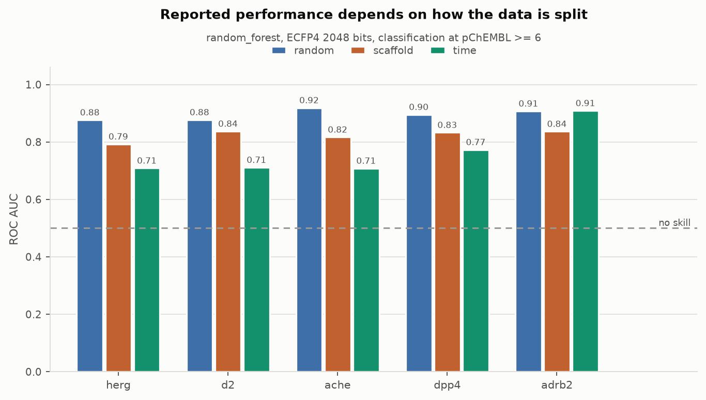

**Classification — ROC AUC at pChEMBL ≥ 6**

| Target | random | scaffold | time | random → scaffold | random → time |
| --- | ---: | ---: | ---: | ---: | ---: |
| hERG | 0.876 | 0.793 | 0.709 | −0.084 | −0.168 |
| D2 | 0.877 | 0.837 | 0.711 | −0.040 | −0.166 |
| AChE | 0.919 | 0.817 | 0.708 | −0.102 | −0.211 |
| DPP-4 | 0.895 | 0.833 | 0.773 | −0.063 | −0.122 |
| β2-adrenergic | 0.907 | 0.837 | 0.909 | −0.071 | **+0.001** |

**Regression — R² on pChEMBL**

| Target | random | scaffold | time |
| --- | ---: | ---: | ---: |
| hERG | 0.586 | 0.389 | 0.145 |
| D2 | 0.649 | 0.469 | 0.119 |
| AChE | 0.697 | 0.437 | 0.262 |
| DPP-4 | 0.640 | 0.455 | 0.271 |
| β2-adrenergic | 0.763 | 0.554 | 0.340 |
| **mean** | **0.667** | **0.461** | **0.227** |

#### How much do random splits overstate performance? Plainly:

Averaged over all **20 target × model pairs** (`results/split_gap.csv`):

| Framing | metric | scaffold split costs | time split costs |
| --- | --- | ---: | ---: |
| Classification | ROC AUC | **−0.079 (−9.0% relative)** | **−0.146 (−16.8% relative)** |
| Regression | Spearman ρ | **−0.148 (−19.7% relative)** | **−0.303 (−41.0% relative)** |

In the regression framing the effect is severe enough to flip the sign of
the result: under a time split, **ridge regression scores a negative R² on
four of the five targets** (hERG −0.74, D2 −0.62, AChE −0.43, DPP-4 −0.26) —
worse than predicting the training mean — while the *same model on the same
data* reports R² 0.39–0.70 under a random split.

Stated as plainly as the data allows: **a random split flatters these models
by about 9% of ROC AUC and about 20% of rank correlation. Reported R² under
a random split is roughly three times what the same model achieves when
asked to predict the chemistry that came next** (0.67 vs 0.23), **and the
random-split RMSE understates the time-split RMSE by 65%** (0.67 vs 1.10 log
units, averaged over the five targets).

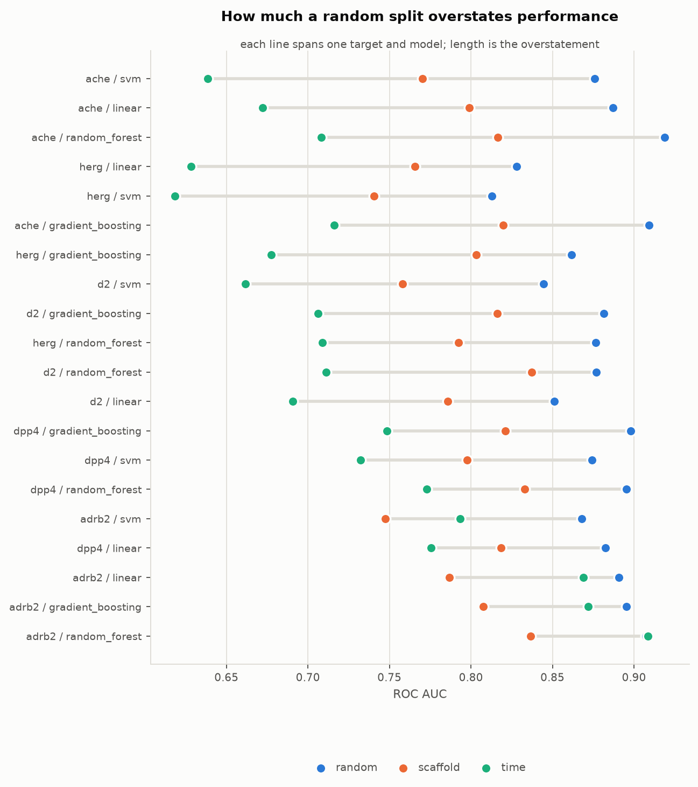

**The one exception, reported rather than buried.** β2-adrenergic under a
time split (0.909) beats its own random split (0.907). It is the smallest
target (2,046 compounds), its time split holds only 372 test compounds, and
**196 compounds were dropped from that split for having no publication
year** — the largest such loss in the study. One target out of five breaking
the pattern on the noisiest split is what an honest table looks like; a
perfectly monotone one would be more suspicious.

#### How much to trust that average

An average over twenty cells needs a spread, and which spread depends on
what you want to generalise over. Two are reported, because they answer
different questions.

**Across targets and models** (`results/split_gap_uncertainty.csv`). The
gap is measured once per target and model, so the twenty cells are twenty
paired observations. This is the spread that belongs beside the headline
sentence, because the sentence is a claim about an average over exactly
those cells:

| Framing | metric | comparison | mean gap | 95% CI | cells agreeing | Wilcoxon p |
| --- | --- | --- | ---: | :---: | ---: | ---: |
| Classification | ROC AUC | random → scaffold | **0.079** | 0.070 – 0.088 | 20/20 | 0.0001 |
| Classification | ROC AUC | random → time | **0.146** | 0.114 – 0.178 | 19/20 | 0.0001 |
| Regression | Spearman ρ | random → scaffold | **0.148** | 0.132 – 0.163 | 20/20 | 0.0001 |
| Regression | Spearman ρ | random → time | **0.303** | 0.259 – 0.348 | 20/20 | 0.0001 |

The interval is a paired t interval; the Wilcoxon signed-rank statistic is
reported beside it because twenty paired values containing one known
exception is precisely the case where a mean and a median can disagree,
and the reader is entitled to see both rather than whichever is prettier.
The single dissenting cell is named in the table rather than averaged
away: β2-adrenergic / random forest, the exception discussed above.

A bootstrap over test compounds — which §5 does use for the enrichment
factors — answers a narrower question: how precisely *this* test set pins
down *this* number. It is the wrong instrument for a claim about an
average over five targets, so it is not the primary estimate here.

**Across split draws** (`results/repeated_splits.csv`). Any one split is a
sample. Re-drawing it under five seeds gives the error bar a
cheminformatics benchmark normally quotes. Random forest, ECFP4, five
seeds per target:

| Target | random (mean ± sd) | scaffold (mean ± sd) | gap ± sd |
| --- | :---: | :---: | ---: |
| hERG | 0.883 ± 0.008 | 0.837 ± 0.014 | 0.046 ± 0.014 |
| D2 | 0.877 ± 0.007 | 0.841 ± 0.017 | 0.036 ± 0.014 |
| AChE | 0.915 ± 0.008 | 0.866 ± 0.011 | 0.049 ± 0.012 |
| DPP-4 | 0.914 ± 0.012 | 0.872 ± 0.032 | 0.042 ± 0.044 |
| β2-adrenergic | 0.913 ± 0.008 | 0.907 ± 0.019 | **0.006 ± 0.025** |

Three things fall out of this table, and the third was not expected.

First, **a scaffold split is roughly twice as volatile as a random one**
(sd 0.011–0.032 against 0.007–0.012). Which chemotypes happen to land in
the test set matters, so a single scaffold split is a noisier instrument
than a single random split — DPP-4 most of all, where the gap's own
standard deviation (0.044) exceeds its mean (0.042).

Second, **β2-adrenergic is the exception on this axis too.** Its gap is
0.006 ± 0.025, indistinguishable from zero, matching its behaviour on the
time split. It is not one odd split; splitting genuinely does not cost
much on that target.

Third, and most usefully: the mean gap here is **0.036, less than half the
headline 0.079**. The repeats have to shuffle the scaffold groups, because
the study's own scaffold split fills the largest chemotypes into training
first and is therefore deterministic — re-seeding it changes nothing. A
shuffled-group split is the easier construction. So **how you build the
scaffold split matters about as much as whether you use one at all**, and
a paper reporting "a scaffold split" without saying which construction has
left out something worth about 0.04 of ROC AUC. The headline number in
this README is the largest-first construction, the harder and more
conservative of the two.

**Across cutoff years** (`results/time_cutoff_sensitivity.csv`). The time
split has no seed — the cutoff determines it — so its counterpart to a
re-draw is moving the line. If the gap only appears at one cutoff it is an
artefact of that choice. Three cutoffs per target, holding out roughly
15%, 20% and 25%:

| Target | gap at each cutoff | verdict |
| --- | --- | --- |
| hERG | +0.222, +0.178, +0.218 | holds |
| D2 | +0.116, +0.175 | holds |
| AChE | +0.184, +0.210 | holds |
| DPP-4 | +0.190, +0.122, +0.147 | holds |
| β2-adrenergic | −0.021, −0.004, +0.009 | **absent at every cutoff** |

The time gap is not an artefact of the cutoff: it survives on four of five
targets wherever the line is drawn, between 0.12 and 0.22. And β2's
exception is not an artefact either — it is absent at all three cutoffs,
as it was across five re-drawn scaffold splits. Three independent ways of
perturbing that target agree that splitting genuinely costs it nothing,
which is a firmer statement than "one odd split" and a more interesting
one.

### 2. Why: a random split leaks most of the test set

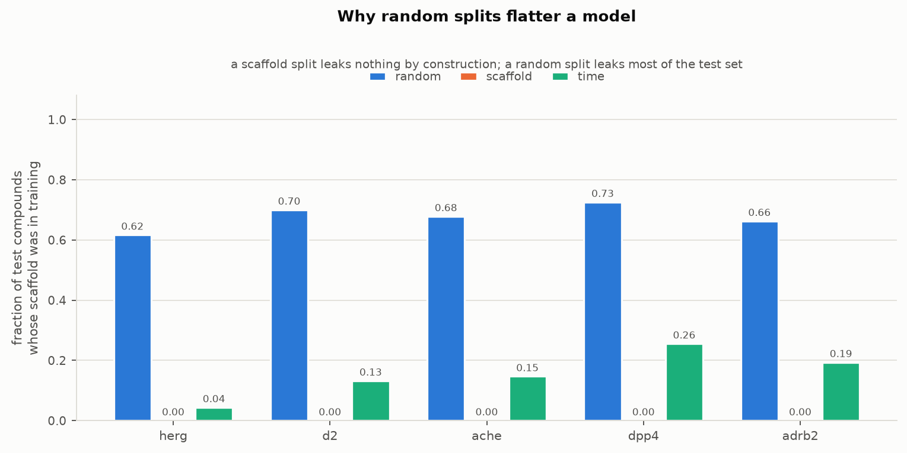

Fraction of test compounds whose Bemis–Murcko scaffold also appears in
training (`results/split_leakage.csv`):

| Target | random | scaffold | time |
| --- | ---: | ---: | ---: |
| hERG | 0.617 | 0.000 | 0.044 |
| D2 | 0.700 | 0.000 | 0.132 |
| AChE | 0.678 | 0.000 | 0.147 |
| DPP-4 | 0.726 | 0.000 | 0.255 |
| β2-adrenergic | 0.663 | 0.000 | 0.194 |

Under a random split **62–73% of test compounds share a ring system with
something the model trained on**. The scaffold split leaks nothing, by
construction, and `tests/test_splits.py` asserts that on the real datasets.
The time split leaks 4–26%, which is roughly how much of a field's chemistry
carries across its cutoff year — least for hERG, whose counter-screen data
turns over fastest, most for DPP-4, whose 2015 cutoff leaves a decade of
gliptin analogues on the far side.

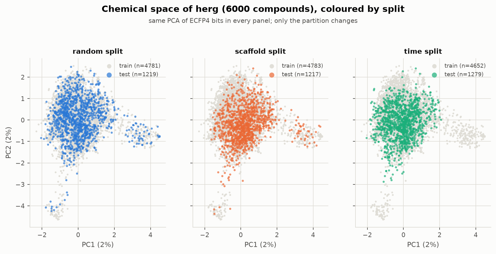

The same PCA in all three panels; only the colouring changes. The random
split speckles its test set evenly through the training distribution, while
the scaffold and time splits leave whole regions untouched. (Two components
of a 2048-bit space explain ~2% of variance each, so this is an
illustration, not evidence — the evidence is the leakage table above.)

### 3. Representations matter, but much less than the protocol

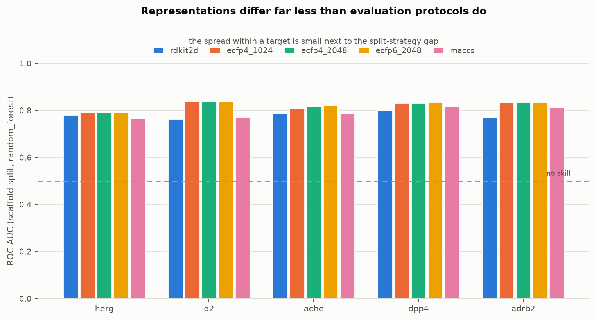

Mean ROC AUC over the five targets, scaffold split
(`results/representation_comparison.csv`):

| Representation | features | logistic regression | random forest |
| --- | ---: | ---: | ---: |
| ECFP6, 2048 bits | 2,048 | 0.770 | **0.824** |
| ECFP4, 2048 bits | 2,048 | **0.791** | 0.823 |
| ECFP4, 1024 bits | 1,024 | 0.782 | 0.821 |
| MACCS keys | 167 | 0.705 | 0.790 |
| RDKit 2D descriptors | 34 | 0.708 | 0.781 |

With a random forest the whole spread across five representations is
**0.043 AUC** — about half the cost of moving from a random to a scaffold
split (0.079), and under a third of the cost of a time split (0.146).
Doubling the fingerprint from 1024 to 2048 bits buys 0.002. Going from
radius 2 to radius 3 buys 0.001.

**The protocol you evaluate under changes the answer more than the features
you feed the model.** That is the practical finding of this repository.

### 4. Applicability domain: error rises as similarity falls

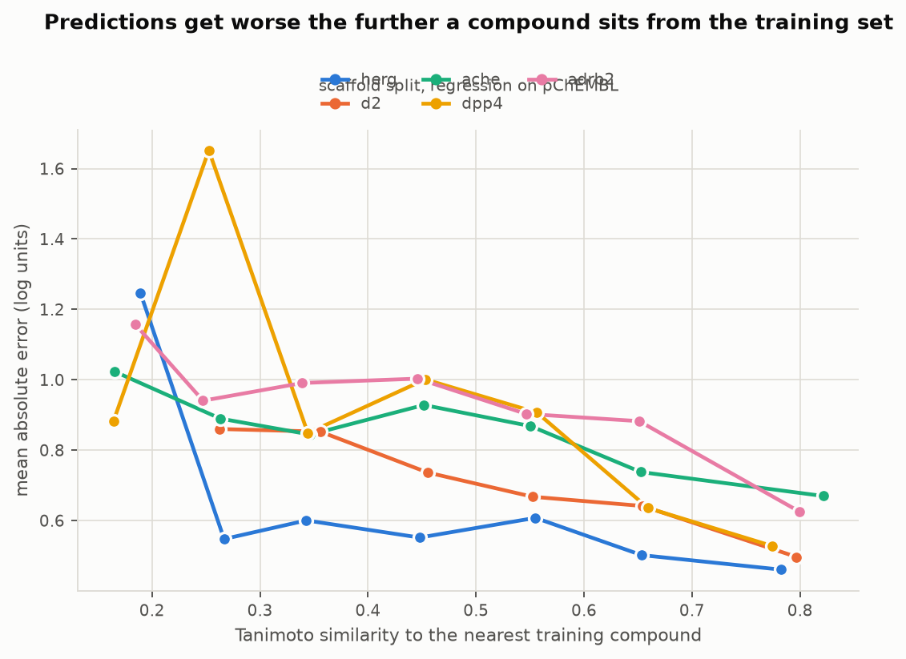

Test compounds binned by Tanimoto similarity to their nearest training
neighbour, scaffold split, random forest regression
(`results/applicability_domain.csv`). Mean absolute error, in log units:

| NN similarity | hERG | D2 | AChE | DPP-4 | β2 |
| --- | ---: | ---: | ---: | ---: | ---: |
| 0.2–0.3 | 0.55 | 0.86 | 0.89 | 1.65 | 0.94 |
| 0.4–0.5 | 0.55 | 0.74 | 0.93 | 1.00 | 1.00 |
| 0.6–0.7 | 0.50 | 0.64 | 0.74 | 0.64 | 0.88 |
| 0.7–1.0 | 0.46 | 0.50 | 0.67 | 0.53 | 0.63 |

The trend is negative on **all five targets** (Spearman ρ between bin
similarity and bin MAE: −0.68, −1.00, −0.82, −0.61, −0.86). Comparing the
0.2–0.3 band with the 0.7–1.0 band, a compound with no close analogue in the
training set is predicted between **1.2× (hERG) and 3.1× (DPP-4) worse**
than one with a near neighbour.

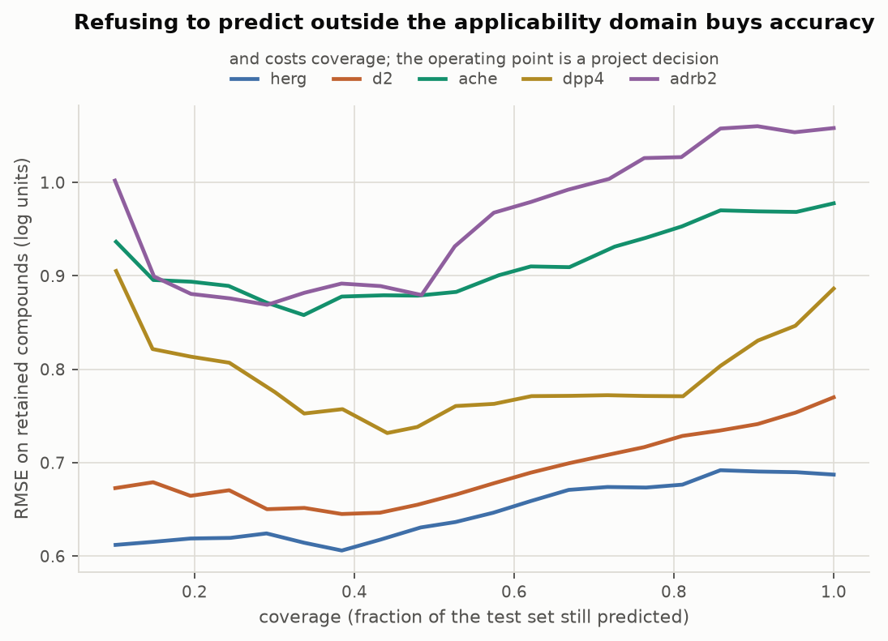

**But the trade-off curve is less generous than the bins suggest.** Refusing
to predict for everything below the 90th similarity percentile — keeping the
most similar 10% of the test set — improves RMSE by 11% on hERG (0.687 →
0.612) and 13% on D2 (0.770 → 0.673), but only 4% on AChE, 5% on β2, and on
DPP-4 it makes things slightly **worse** (0.886 → 0.905). The applicability
domain reliably flags *which* predictions are shaky; it is a much blunter
instrument for buying accuracy back, because the retained set is still
chemically heterogeneous. Both results are in `results/coverage_curve.csv`.

### 5. Screening metrics, and an honest look at their ceiling

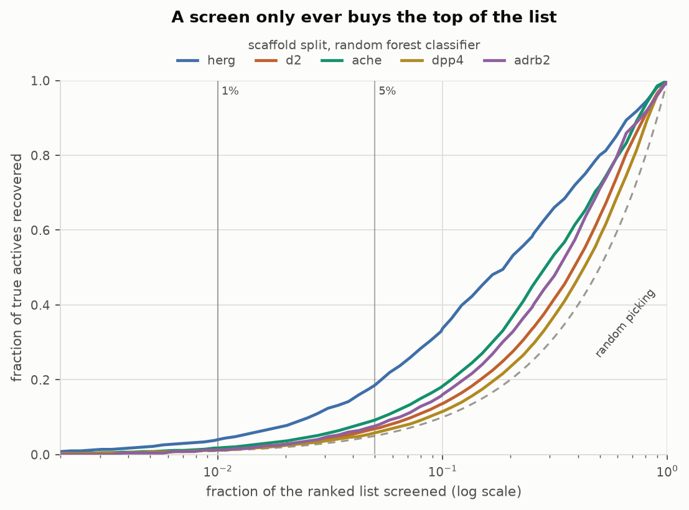

A screen only buys the top of the list, so this is the table that matters —
scaffold split, random forest (`results/screening_demo.csv`). Intervals are
400-resample bootstraps over test compounds:

| Target | test set | active rate | top 1% | hit rate | recall | EF@1% (95% CI) | EF ceiling | recall@5% | EF@5% |
| --- | ---: | ---: | ---: | ---: | ---: | ---: | ---: | ---: | ---: |
| hERG | 2,207 | 22.7% | 22 cpds | **90.9%** | 4.0% | **4.01** (3.40–4.56) | 4.41 | 18.6% | 3.72 |
| D2 | 1,817 | 72.3% | 18 cpds | 100% | 1.4% | 1.38 (1.35–1.43) | 1.38 | 6.9% | 1.38 |
| AChE | 1,200 | 52.3% | 12 cpds | 91.7% | 1.8% | 1.75 (1.32–1.98) | 1.91 | 9.2% | 1.85 |
| DPP-4 | 875 | 82.4% | 9 cpds | 100% | 1.3% | 1.21 (1.18–1.25) | 1.21 | 5.8% | 1.16 |
| β2 | 409 | 60.9% | 4 cpds | 75.0% | 1.2% | 1.23 (0.37–1.74) | 1.64 | 7.6% | 1.56 |

**Read the ceiling column before the EF column.** Enrichment cannot exceed
`min(1/f, 1/active_rate)`. On D2 and DPP-4, 72% and 82% of test compounds
are already active, so the best possible EF at 1% is 1.38 and 1.21 — and the
model hits both exactly. Those are not weak results, they are **saturated**
ones, and quoting "EF = 1.2" without the ceiling would badly misrepresent
them. hERG, the only genuinely imbalanced target, is where enrichment has
room to mean something: EF 4.01 against a ceiling of 4.41, with a hit rate
of 91% in the top 22 compounds.

The same caution applies to BEDROC. **BEDROC = 0.5 is not chance** — at
these alphas the random-ranking expectation is essentially the active ratio,
so the random baseline is 0.23 on hERG, 0.52 on AChE and 0.82 on DPP-4.
hERG's BEDROC of 0.93 clears its baseline by 0.70; DPP-4's higher-looking
1.00 clears its own by 0.18. Every BEDROC in
`results/split_comparison.csv` therefore sits next to its own baseline
(`bedroc_1pct_random`), because the raw value alone is uninterpretable.

The β2 row shows why confidence intervals belong in the table: the top 1% of
409 compounds is **four molecules**, and the EF interval (0.37–1.74) spans
from worse-than-random to near-ceiling.

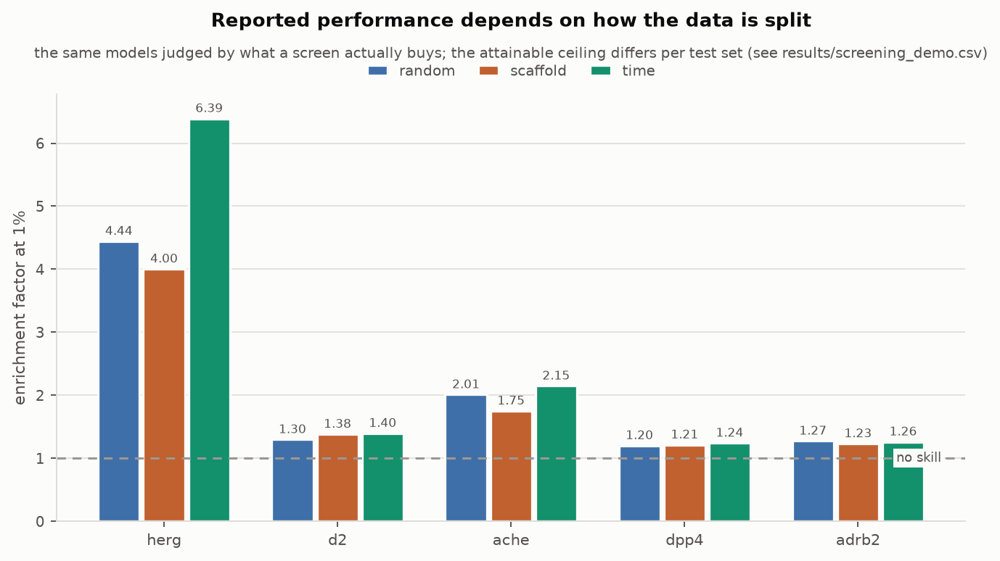

**And here is the trap that makes the ceiling column non-negotiable.**
Judged by enrichment, the split-strategy ordering appears to *reverse*: hERG
scores EF 4.44 under a random split but **6.39 under a time split**, its
worst split by every other measure (ROC AUC 0.709). The explanation is not
that the model got better at extrapolating. It is that the time-split test
set is less active (15.7% vs 21.5%), which raises the attainable ceiling
from 4.66 to 6.39 — and the model is pinned near that ceiling either way:
95% of it under the random split, and exactly on it under the time split.

So enrichment — and any other metric that moves with class balance, PR AUC
included — **cannot be compared across splits here at all**, because each
split produces a test set with a different active rate and therefore a
different ceiling. ROC AUC, being invariant to class balance, can. That is
the practical reason the headline comparison in §1 is led with AUC, and why
the enrichment table is reported per target beside its own ceiling rather
than the other way round.

### 6. Calibration

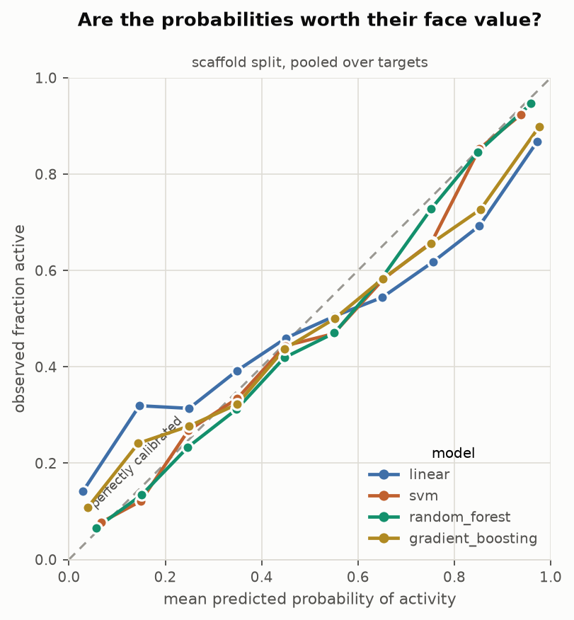

Expected calibration error, pooled over targets (`results/calibration.csv`):

| Model | random | scaffold | time |
| --- | ---: | ---: | ---: |
| random forest | 0.031 | **0.048** | 0.051 |
| linear SVM (Platt-scaled) | 0.085 | 0.058 | 0.069 |
| gradient boosting | 0.046 | 0.098 | 0.103 |
| logistic regression | 0.089 | **0.129** | 0.177 |

Two things worth noting. **Calibration degrades with split difficulty for
three of the four models** — a model out of its domain is not only less
accurate, it is also more wrong about how confident it should be, which is
the worse failure if the probability feeds a decision rule. Logistic
regression is the clearest case, doubling its ECE from 0.089 to 0.177.

The exception is the linear SVM, which actually improves from random to
scaffold (0.085 → 0.058), and it is an artefact worth naming: that model is
**Platt-scaled by internal cross-validation** while the other three report
raw probabilities. Its calibration is a property of the pipeline, not a
discovery about SVMs, and it is fitted on the training split, so it tracks
split difficulty differently from the rest.

### 7. The signal is real: y-scrambling

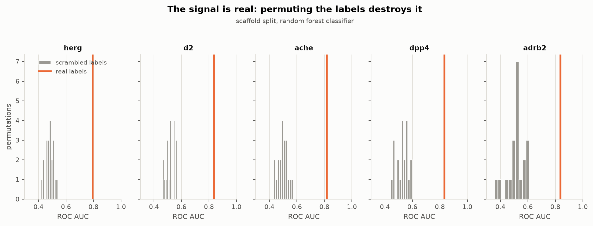

Twenty label permutations per target, refitting the whole pipeline each
time, scored on the untouched scaffold-split test set
(`results/y_scrambling.csv`):

| Target | observed AUC | null mean ± SD | null max | z | p |
| --- | ---: | ---: | ---: | ---: | ---: |
| hERG | 0.793 | 0.480 ± 0.029 | 0.539 | 10.7 | 0.048 |
| D2 | 0.837 | 0.522 ± 0.032 | 0.567 | 9.9 | 0.048 |
| AChE | 0.817 | 0.499 ± 0.036 | 0.577 | 8.8 | 0.048 |
| DPP-4 | 0.833 | 0.527 ± 0.043 | 0.598 | 7.2 | 0.048 |
| β2 | 0.837 | 0.518 ± 0.063 | 0.612 | 5.1 | 0.048 |

Every null distribution sits on chance, which says the test itself is
calibrated; every observed score sits 5–11 standard deviations above its own
null, and above the maximum of all 20 permutations. p = 0.048 is the floor
with 20 permutations, not a borderline result. **The models have learned
real structure–activity relationships — the scaffold-split numbers are the
honest size of what they learned, not an absence of signal.**

### 8. A screening library, and the control that says whether to believe it

§5 could not say much, because a benchmark that is 50–83% active caps
enrichment at 1.2–1.9. So this section builds the other situation: 150
measured actives per target, surrounded by **up to 49 property-matched
decoys each** drawn from the compounds measured against the *other four*
targets and absent from this one. Decoys are matched on molecular weight,
logP, donors, acceptors, rotatable bonds and TPSA — the bulk properties a
model could otherwise exploit instead of learning pharmacology — and
anything above 0.35 Tanimoto to an active is refused as a possible
analogue.

Three things in that construction exist because the first version of it
produced a benchmark that looked well built and was not.

**Matching is distance-capped.** Nearest-available matching always
succeeds: when the pool holds nothing resembling an active, it returns
the least bad compound and the summary reports a full decoy set. An
active with no candidate within 1.0 standardised units is now dropped and
counted (`--decoy-max-distance`), which turns a hidden mismatch into a
visible shortfall.

**The split is stratified by class.** A plain scaffold split over the
whole library fills training largest-group-first, and because actives are
scaffold-clustered while decoys are mostly singletons, the test active
rate landed at 5.6% against a 2% library. Enrichment factor is bounded by
`1 / active_rate` *of the set it is computed on*, so that quietly lowered
the ceiling the result was measured against: the previous version of this
section reported "EF 17.9 of 17.9" when the library it claimed to
represent had a ceiling of 50. `splits.stratified_scaffold_split` splits
each class on its own scaffolds, which holds the test rate at the
library's and keeps the scaffold separation inside each class.

**Every benchmark is scored twice.** The second model gets *only the six
matched properties* and no structural information at all. Whatever it
achieves is available without any pharmacology, so it is the measurement
of artificial enrichment rather than an argument about it.

What the construction costs (`results/decoy_construction.csv`):

| Target | actives kept | dropped | decoys | ratio | active rate | ceiling | worst property | bias |
| --- | ---: | ---: | ---: | ---: | ---: | ---: | --- | ---: |
| hERG | 148 | 2 | 5,838 | 39.5 | 2.47% | 40.5 | MolWt | 0.31 |
| D2 | 150 | 0 | 6,940 | 46.3 | 2.12% | 47.3 | MolWt | 0.20 |
| AChE | 140 | 10 | 5,526 | 39.5 | 2.47% | 40.5 | MolLogP | 0.33 |
| DPP-4 | 143 | 7 | 4,830 | 33.8 | 2.88% | 34.8 | MolLogP | **0.87** |
| β2-adrenergic | 102 | **48** | 1,890 | 18.5 | 5.12% | 19.5 | NumHDonors | **1.06** |

And what the screen says (`results/decoy_screen.csv`), with the
property-only control beside each row:

| Target | test active rate | ROC AUC | EF@1% | ceiling | hit rate @1% | control AUC | control EF@1% |
| --- | ---: | ---: | ---: | ---: | ---: | ---: | ---: |
| hERG | 2.50% | 0.921 | 29.9 | 39.9 | 0.75 | 0.489 | 0.0 |
| D2 | 2.12% | 0.922 | 33.8 | 47.3 | 0.71 | 0.455 | 3.4 |
| AChE | 2.47% | 0.949 | 40.5 | 40.5 | **1.00** | 0.598 | 0.0 |
| DPP-4 | 2.92% | 0.954 | 34.3 | 34.3 | **1.00** | 0.540 | 0.0 |
| β2-adrenergic | 5.03% | 0.902 | 19.9 | 19.9 | **1.00** | **0.669** | **14.9** |

**The control is the finding.** On four of the five targets a model given
the six matched properties scores **0.455 to 0.598 AUC** — chance — and
an enrichment factor of essentially zero. Those six numbers carry no
usable signal, so the enrichment the fingerprint model achieves is not
the property artefact that the earlier version of this section assumed it
was. The matching worked, and the control is what establishes that;
inspecting the bias column could only ever have suggested it.

**On β2 the control fails, and that benchmark should not be quoted.** Six
properties reach 0.669 AUC and EF 14.9 against a ceiling of 19.9 — about
three quarters of the achievable enrichment with no structural
information whatsoever. The cause is in the breakdown
(`results/decoy_property_bias.csv`): β2 actives carry a standardised
**+1.06 on hydrogen-bond donors**. Beta-2 agonists are catecholamine-like
and the cross-target pool contains almost nothing with four or five
donors, which is also why the distance cap had to discard 48 of the 150
actives and why its ceiling fell from 50 to 19.5. No amount of
re-matching fixes that; a different pool is the only fix.

Two further honest costs. The distance cap **helps where the pool fits
badly and mildly hurts where it fits well**: on β2 it improves every
absolute property difference, while on hERG the aggregate bias rises from
0.12 to 0.31, because actives in sparse regions keep full weight in the
active mean while contributing fewer decoys. That rise is visible and
tolerated, because the control — AUC 0.489 — shows it did not make the
benchmark exploitable. It is also why the control, not the bias column,
is the diagnostic to read. And **three of five benchmarks still sit on
the ceiling** with a hit rate of 1.00; only hERG and D2 now show genuine
headroom, at 0.75 and 0.71.

So §5 and §8 still fail in opposite directions, and neither EF is the
number to quote on its own. The measured benchmark is too hard to show
enrichment; this one is too easy on three targets and property-biased on
one. What is now settled is *which* kind of failure each is, and on hERG
and D2 the enrichment survives a control that would have exposed it. The
remaining fix is unchanged: decoys from a diverse vendor library nobody
has tested against anything.

### 9. Conformal prediction: coverage you can hold the model to

Ranking invites the question *how far down do I read?*. Conformal
prediction answers it. Holding out 25% of the training set for
calibration, each test compound gets a **prediction set** with a proved
property: under exchangeability the true label is inside it at least
`1 - ε` of the time, whatever the underlying model. Calibration is
class-conditional (Mondrian), so the promise holds for the actives
separately rather than being bought by being right about the majority
class (`results/conformal.csv`).

At 90% confidence, random forest, ECFP4:

| Target | split | coverage | coverage (actives) | singletons | both labels | valid |
| --- | --- | ---: | ---: | ---: | ---: | :---: |
| hERG | random | 0.909 | 0.888 | 70% | 30% | ✅ |
| hERG | scaffold | 0.897 | 0.890 | 50% | 50% | ✅ |
| D2 | random | 0.902 | 0.909 | 72% | 28% | ✅ |
| D2 | scaffold | 0.894 | 0.887 | 63% | 37% | ✅ |
| AChE | random | 0.897 | 0.879 | 83% | 17% | ✅ |
| AChE | scaffold | 0.852 | 0.822 | 71% | 29% | ❌ |
| DPP-4 | random | 0.889 | 0.886 | 81% | 19% | ✅ |
| DPP-4 | scaffold | 0.847 | 0.842 | 70% | 30% | ❌ |
| β2 | random | 0.895 | 0.891 | 88% | 12% | ✅ |
| β2 | scaffold | 0.910 | 0.896 | 61% | 39% | ✅ |

Two things, and the second is the interesting one.

**On a random split the guarantee holds, and it is useful.** Coverage
lands on 0.89–0.91 against a promised 0.90, and 70–88% of compounds get an
unambiguous call. "These 312 compounds, 90% confidence, and for 260 of
them the model has committed itself" is something a project can act on in
a way that a ranked list is not.

**On a scaffold split it starts to fail — and it should.** Coverage drops
to 0.85 on AChE and DPP-4, missing the promise. This is not a bug in the
implementation; it is the assumption being violated in front of you. The
conformal guarantee holds **under exchangeability** between the
calibration set and the test set, and a scaffold split is *constructed* to
break exactly that: the test compounds come from chemotypes the
calibration compounds do not cover. Across all five targets and three
significance levels, 22 of 30 runs are valid, and **every one of the eight
failures is on a scaffold split**.

That is the same lesson as §1 arriving by a different route. A method
whose guarantee is proved on paper still inherits the evaluation's
assumptions, and the split that makes a model look worse is also the split
that invalidates the promise attached to it. The honest reading: use
conformal prediction on prospective compounds that resemble your training
chemistry, and distrust its interval on the ones that do not — which,
inconveniently, are the compounds a discovery project most wants to score.
Mondrian conformal on a scaffold split is a research problem, not a
settled tool.

Efficiency behaves as it should throughout: the harder the split, the more
often the model returns both labels instead of committing (30% → 50% on
hERG). No prediction set was ever empty.

---

## The data

All bioactivity comes from the **ChEMBL REST API**
(<https://www.ebi.ac.uk/chembl/api/data/>), fetched on **2026-11-21** and
cached in `data/` with a `.meta.json` recording the target, the fetch date,
every record count and the full attrition table — so the repository runs
offline and every number stays auditable.

Five human targets were checked against live record counts before being
committed to. **All five cleared the 800-compound threshold, so none was
dropped.**

| Target | ChEMBL ID | Why it is here | Raw | Exact | **Compounds** | Scaffolds | Docs | Years | Active @ 1 µM |
| --- | --- | --- | ---: | ---: | ---: | ---: | ---: | --- | ---: |
| hERG channel (KCNH2) | `CHEMBL240` | Cardiotoxicity. Predicting hERG block kills candidates, not just papers | 20,080 | 12,253 | **11,034** | 5,557 | 2,480 | 1995–2025 | 21.9% |
| Dopamine D2 (DRD2) | `CHEMBL217` | The canonical antipsychotic target and the field's most-used benchmark | 17,328 | 12,991 | **9,085** | 3,750 | 861 | 1987–2025 | 77.6% |
| Acetylcholinesterase | `CHEMBL220` | Alzheimer's symptomatic therapy; decades of diverse chemistry | 9,764 | 7,123 | **6,000** | 2,563 | 709 | 1986–2025 | 50.0% |
| DPP-4 | `CHEMBL284` | Type 2 diabetes, the gliptins — the antidiabetic thread from the author's prior work | 6,394 | 4,902 | **4,375** | 1,600 | 295 | 1996–2025 | 83.5% |
| β2-adrenergic | `CHEMBL210` | Asthma/COPD bronchodilators; a GPCR with both agonist and antagonist chemistry | 3,585 | 2,729 | **2,046** | 933 | 241 | 1991–2025 | 74.2% |

Endpoint mix (`results/dataset_summary.csv`): hERG is 87% IC50, D2 is 85%
Ki, AChE 94% IC50, DPP-4 89% IC50, and β2 is the most mixed at 53% EC50 /
25% IC50 / 21% Ki.

> **The class balances are a finding in themselves.** Four of five targets
> are *majority active* at 1 µM — DPP-4 is 83% active. ChEMBL records what
> people chose to publish, which is mostly compounds from series they were
> already optimising. A real screening library is a fraction of a percent
> active. This is why the enrichment ceilings in §5 are so low, and why
> these EF values do not transfer to a prospective campaign.

### Cleaning and attrition

Every step is counted, per target, in `results/attrition.csv`. Censored
measurements are discarded, not clipped: `IC50 > 10000 nM` is a bound, not a
measurement, and treating it as one injects false potencies into training.

| Step | hERG | D2 | AChE | DPP-4 | β2 |
| --- | ---: | ---: | ---: | ---: | ---: |
| Raw activity records from the API | 20,080 | 17,328 | 9,764 | 6,394 | 3,585 |
| − missing SMILES or unparseable potency | −7 | −100 | −32 | −9 | −52 |
| − **censored relation** (`>`, `<`, `≥`, `≤`, `~`) | −6,047 | −2,500 | −1,131 | −825 | −484 |
| − ChEMBL duplicate flag or validity comment | −1,759 | −1,530 | −1,465 | −654 | −315 |
| − potency outside 0.1 pM – 100 mM | 0 | 0 | 0 | 0 | 0 |
| − RDKit parse failure or outside size window | −14 | −207 | −13 | −4 | −5 |
| **Exact measurements retained** | 12,253 | 12,991 | 7,123 | 4,902 | 2,729 |
| − replicates merged to median pChEMBL | −1,219 | −3,906 | −1,123 | −527 | −683 |
| **Unique compounds modelled** | **11,034** | **9,085** | **6,000** | **4,375** | **2,046** |

Censoring removes 30% of hERG's records — by far the largest single loss,
and exactly what you would expect of a counter-screen where most compounds
are reported as "inactive above 10 µM".

Structures are desalted to their largest fragment and then **neutralised**,
so a hydrochloride, a sodium salt and the free parent collapse onto one
structure before deduplication. Without that step they would stay separate
rows with correlated labels — precisely the near-duplicate pairs that can
straddle a split. Potencies are converted by recomputation from the
nanomolar value (`pChEMBL = 9 − log₁₀[nM]`) rather than by trusting ChEMBL's
own field, and replicates of one structure collapse to their **median**.

---

## Methods

### Representations

| Slug | What it is | Features |
| --- | --- | ---: |
| `rdkit2d` | Interpretable RDKit 2D descriptors — weight, cLogP, TPSA, ring and rotatable-bond counts, fraction sp³, Chi/Kappa connectivity indices, partial-charge and E-state summaries | 34 |
| `ecfp4_1024` | Morgan circular fingerprint, radius 2, folded to 1024 bits | 1,024 |
| `ecfp4_2048` | Morgan circular fingerprint, radius 2, folded to 2048 bits — the field's default, and what every analysis outside §3 uses | 2,048 |
| `ecfp6_2048` | Morgan circular fingerprint, radius 3 — larger atom environments | 2,048 |
| `maccs` | MACCS structural keys: a fixed, hand-curated substructure vocabulary | 167 |

### Models

Four families spanning capacity, with **no per-cell hyperparameter tuning** —
tuning each of the 120 cells would confound the comparison of evaluation
protocols with tuning noise.

| Slug | Classification | Regression |
| --- | --- | --- |
| `linear` | L2 logistic regression, balanced class weights | Ridge |
| `svm` | Linear SVM, Platt-scaled to probabilities by 3-fold internal CV | Linear SVR |
| `random_forest` | 300 trees, `sqrt` features per split | 300 trees |
| `gradient_boosting` | Histogram gradient boosting, 200 rounds | same |

Dense descriptor blocks are median-imputed and standardised; binary
fingerprints have their all-zero bits dropped.

Both framings run on identical splits: **regression** on pChEMBL, and
**classification** at **pChEMBL ≥ 6.0** (1 µM).

> **Why that threshold.** 1 µM is the conventional line for "this compound
> does something at this target" in public bioactivity data: roughly where
> cell-based assays stop being dominated by non-specific effects, and the
> usual floor for a hit worth optimising. It is a round number near the
> middle of the ChEMBL potency distribution. It is still a choice, so it is
> recorded in every result row and the class balance it produces is reported
> per target above.

### Splits

All three hold out **20%**, applied to the same cleaned table with the same
models and the same seed. Only the partition changes.

| Strategy | Construction | What it asks |
| --- | --- | --- |
| `random` | Uniform random, seeded | Can you score compounds from the same pool you trained on? |
| `scaffold` | Bemis–Murcko groups kept intact; the largest groups go to training, so the test set is the long tail of rarer chemotypes | Can you score a chemotype you have never seen? |
| `time` | Cutoff on first-publication year, chosen so the test fraction lands nearest 20% (cutoffs 2020, 2020, 2021, 2015, 2019) | Can you score the chemistry that came next? |

The scaffold and time splits take **no seed** — they are deterministic
functions of the chemistry and of the publication record — so nothing
reported under them can be a lucky draw. Compounds with no publication year
are excluded from the time split and counted (`n_unknown_year`: 126, 34, 23,
0 and 196).

### Metrics

Regression: R², RMSE, MAE, Pearson *r*, Spearman ρ.

Classification: ROC AUC, PR AUC, balanced accuracy, MCC, Brier, log loss,
expected calibration error, and the screening metrics that decide whether a
model is worth using:

- **Enrichment factor** at 1% and 5%, always beside its attainable ceiling
  `min(1/f, 1/active_rate)`.
- **BEDROC** at the alphas that put 80% of the weight in the top 1% and 5%
  (`α = ln 5 / f`, so 160.9 and 32.2), always beside its random baseline.
- **Calibration**: reliability curves and ECE, for when a probability is
  used as a number rather than as a rank.

95% confidence intervals are 400-resample bootstraps over test compounds.
They capture test-set sampling error only — the variance from *choosing a
different split* is larger, and is the subject of the whole study.

---

## Limitations

Read every number above with these in mind.

1. **Public bioactivity data is heterogeneous.** The labels pool IC50, Ki and
   EC50 from hundreds of assays and laboratories over four decades, with
   different cell lines, incubation times and readouts. The same compound
   measured twice in the literature routinely differs by half a log unit. A
   large part of the residual error is assay noise that no representation can
   model, and no RMSE here should be read as the model's intrinsic limit.
2. **ChEMBL is a biased sample of chemistry**, as the 50–83% active rates
   show. The enrichment factors characterise the ranking on *this* test set;
   they are not the yield of a campaign against a real library.
3. **Decoys are presumed inactive, and on three targets still too easy.**
   §8 builds a 2%-active decoy library, but its decoys come from the other
   targets in the study: a compound tested against D2 and never against
   hERG is *probably* not a hERG blocker, and nobody checked. The
   property-only control clears four of the five benchmarks — six bulk
   properties score at chance — so the enrichment there is not a property
   artefact. But the model still clears the top 1% perfectly on AChE,
   DPP-4 and β2, and on **β2 the control reaches 0.669 AUC and EF 14.9 of
   a 19.9 ceiling**, so that benchmark is exploitable without any
   pharmacology and should not be quoted. Decoys from an untested vendor
   library are the fix. The measured benchmark in §5 has the opposite
   problem: its inactives are chemically close to its actives because
   somebody made them in the same series.
4. **Activity cliffs.** A single atom can cost two log units of potency.
   Methods built on 2D similarity cannot see that, and scaffold splits land
   the model squarely where it happens.
5. **No 3D, no protein structure.** Purely ligand-based: no pose, no induced
   fit, no account of *why* a compound binds, and no way to reason about
   selectivity between related targets.
6. **No ADMET, no synthetic accessibility, no novelty filter.** A top-ranked
   compound may be unmakeable, insoluble, promiscuous or long since patented.
7. **In vitro potency is not a drug.** Nothing here speaks to exposure,
   distribution, metabolism, therapeutic window or efficacy in a patient.
8. **The time split conflates chemistry with practice.** Compounds published
   after the cutoff differ not only in structure but in which assay protocols
   and research groups produced them. Its drop is an upper bound on the
   purely chemical generalisation gap — and a fair estimate of the gap a real
   project faces.
9. **One split per strategy in the headline grid.** The 170-cell table draws
   each split once. §1 puts two spreads around that — across the twenty
   target × model cells, and across five re-draws of the random and
   scaffold splits — but the re-draws cover the default model and
   representation only, and the time split cannot be re-drawn at all
   because the cutoff year determines it.
10. **The conformal guarantee is not safe on a scaffold split.** §9 shows
   coverage failing on two of five targets there, because the split breaks
   the exchangeability the proof assumes. The prediction sets in this
   repository are trustworthy on a random split and indicative at best on
   a scaffold one.
11. **No per-cell hyperparameter tuning**, deliberately. The absolute numbers
    are honest defaults, not the best attainable.
12. **A threshold is a modelling choice.** pChEMBL ≥ 6 is defensible and
    stated, but for hERG in particular 1 µM block is a liability flag, not a
    regulatory criterion.

---

## How this relates to the author's prior SUR1 work

This project is the general, ligand-based, multi-target counterpart to
**[sur1-antidiabetic-discovery](https://github.com/itsgichia/sur1-antidiabetic-discovery)**,
which re-implements a single-target docking and QSAR workflow for the
sulfonylurea receptor SUR1 (ChEMBL `CHEMBL2096972`, 63 compounds) and
prepares AutoDock Vina runs against PDB `6BAA`.

|  | SUR1 repository | this repository |
| --- | --- | --- |
| Targets | 1 (SUR1 / Kir6.2 complex) | 5 human targets |
| Compounds | 63 | 32,540 |
| Question | *which analogues of this scaffold should we dock?* | *how well do ligand-based models generalise, honestly measured?* |
| Methods | RDKit descriptors, QSAR, virtual library, docking prep | 5 representations, 4 models, 3 split strategies, applicability domain, null models, screening metrics |
| Structure used | yes — cryo-EM receptor, docking box | no — 2D ligand only |

**The two explain each other.** The SUR1 repository reports a best
cross-validated R² of 0.115 and says plainly that its models barely beat
predicting the mean. This study shows that is the *expected* result rather
than a failure of that pipeline: with 63 compounds spread over 32 scaffolds,
a scaffold-aware evaluation asks the model to extrapolate to new chemistry
from almost no examples of any one series — the hardest corner of the regime
measured here, where even 11,000 compounds still leave R² at 0.39.

**Where they would join up.** A real campaign uses both, in order, for
different costs:

1. **Rank cheaply, at scale** — a ligand-based model of the kind built here
   scores millions of compounds for the price of a fingerprint. Its job is to
   discard 99% of the library.
2. **Decide what to trust** — the applicability domain from this repository
   says which of those scores mean anything. Compounds far from the training
   set get a prediction, but not a decision.
3. **Dock the survivors** — structure-based scoring, as set up in the SUR1
   repository, is too expensive for a library and too valuable to skip on a
   shortlist. It earns its cost exactly where the ligand-based model is
   weakest: novel scaffolds outside the applicability domain, where there is
   no close analogue to learn from but there is still a binding site.
4. **Then synthesise and assay.** Neither repository is evidence about a
   molecule. Both are ways of deciding what to test first.

---

## How to run

Requires **Python 3.12+**. Every dependency installs from pip wheels on
macOS arm64, Linux x86-64 and Windows.

```bash
git clone https://github.com/itsgichia/ligand-activity-ml.git
cd ligand-activity-ml

python3.12 -m venv .venv
source .venv/bin/activate          # Windows: .venv\Scripts\activate
pip install -r requirements.txt
```

The cached datasets are committed, so the study runs **offline**:

```bash
# The full matrix: every table in results/ and every figure in figures/
python scripts/run_study.py

# A quick subset, for checking the pipeline works
python scripts/run_study.py --fast

# Subset anything
python scripts/run_study.py --targets herg dpp4 --models linear random_forest
python scripts/run_study.py --splits random scaffold --tasks classification
python scripts/run_study.py --skip nulls space --permutations 5

# Re-fetch live data from ChEMBL (overwrites data/, ~15 minutes)
python -m ligandml.chembl --fetch-all
python -m ligandml.chembl --list          # candidate targets and live counts

# Tests
pytest -q
```

**Runtime.** The committed run took **13.4 minutes** on an 8-core M-series
laptop for 170 fitted cells (`results/run_summary.json` records it). Earlier
runs of the identical matrix on a more heavily loaded machine took 15.3 and
26.7 minutes, so treat 13–27 minutes as the range rather than 13 as a
promise. About a third
of it is the 20-permutation y-scrambling, which refits the random forest 100
times: `--skip nulls` removes that, and `--fast` finishes in about 3
minutes. A fresh clone adds roughly 4 minutes on the first run to compute
the feature matrices, which are then cached in `data/features/` (gitignored,
regenerated on demand).

### Reproducibility

Everything stochastic derives from one seed, `ligandml.RANDOM_STATE =
20261121`, so re-running on the cached CSVs reproduces every number in this
README exactly — checked by running the study end to end twice and comparing.
`results/run_summary.json` records the seed, the matrix, the wall clock and
the exact library versions.

**One pin worth knowing about:** `requirements.txt` holds RDKit below
2026.9. In rdkit 2026.09.2, `Chem.MurckoDecompose` raises
`RuntimeError("bad any cast")` on *every* molecule, which silently removes
the ability to compute Bemis–Murcko scaffolds and therefore the scaffold
split — the core of this study. 2025.3.6 is the last release verified
working here.

### Tests

`pytest -q` runs **370 tests** offline in well under a minute. They target the
failures that would silently corrupt results rather than crash the pipeline:

- **Cleaning** — censored rows dropped for every relation, pChEMBL
  conversion against hand-computed values, ChEMBL's own `pchembl_value`
  deliberately ignored, salts merged with their parents, deduplication
  order-independent and idempotent, attrition table internally consistent.
- **Scaffold-split integrity** — no scaffold group straddles the boundary,
  across 32 combinations of seed and test size, *and* on the real datasets.
- **Metric correctness** — enrichment factor against three hand-computed
  fixtures plus its ceiling and tie-breaking behaviour, BEDROC bounded and
  matching its own random expectation, and the identity
  `EF_f = recall_f / f`.
- **Applicability domain** — monotonicity on a synthetic case where error is
  constructed linear in (1 − similarity), *plus a flat-error control* so the
  test cannot pass by construction.
- **Null models** — real signal is detected, and label-independent features
  are correctly *not* called significant.
- **Reproducibility** — identical results across repeated runs, scaffold and
  time splits invariant to seed and to row order, and the committed result
  tables checked for internal consistency against one another.

### Layout

```
ligandml/
  chembl.py       ChEMBL REST fetch, cleaning policy, attrition, cache (CLI)
  featurise.py    RDKit 2D descriptors, Morgan/ECFP fingerprints, MACCS keys
  splits.py       Random, scaffold, time, and class-stratified scaffold splits
  models.py       Linear, SVM, random forest, gradient boosting; both framings
  evaluate.py     Regression, classification, EF, BEDROC, calibration, bootstrap
  domain.py       Applicability domain by nearest-neighbour Tanimoto
  nulls.py        Y-scrambling null models
  uncertainty.py  Spread on the split-gap estimate
  decoys.py       Property-matched decoy libraries, distance-capped
  conformal.py    Prediction sets with a coverage guarantee
  plots.py        The figures, in one shared visual system
scripts/run_study.py   The whole study, end to end
tests/                 471 tests
data/                  Cached ChEMBL CSVs + provenance JSON (committed)
results/               20 result tables + run_summary.json
figures/               11 figures
```

---

## Author

**Gichia Muiruri**

- BSc (Hons) Pharmaceutical Chemistry — International Medical University, Malaysia
- MSc Health Data Science — University of New South Wales, Sydney
- LinkedIn: <https://www.linkedin.com/in/gichia-muiruri>
- GitHub: <https://github.com/itsgichia>

## License

Released under the [MIT License](LICENSE). Copyright (c) 2026 Gichia Muiruri.

Bioactivity data are retrieved from **ChEMBL** (EMBL-EBI), released under
CC BY-SA 3.0. Please cite ChEMBL directly if you use the cached datasets.
